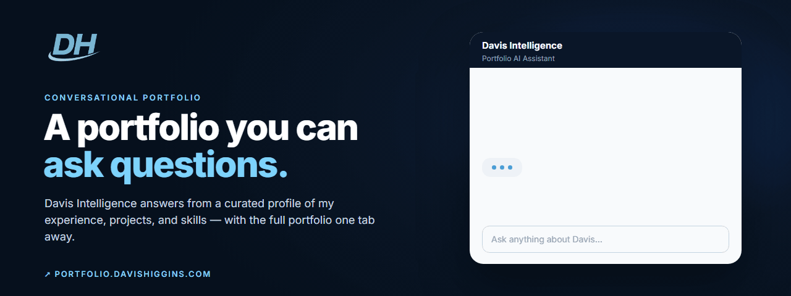
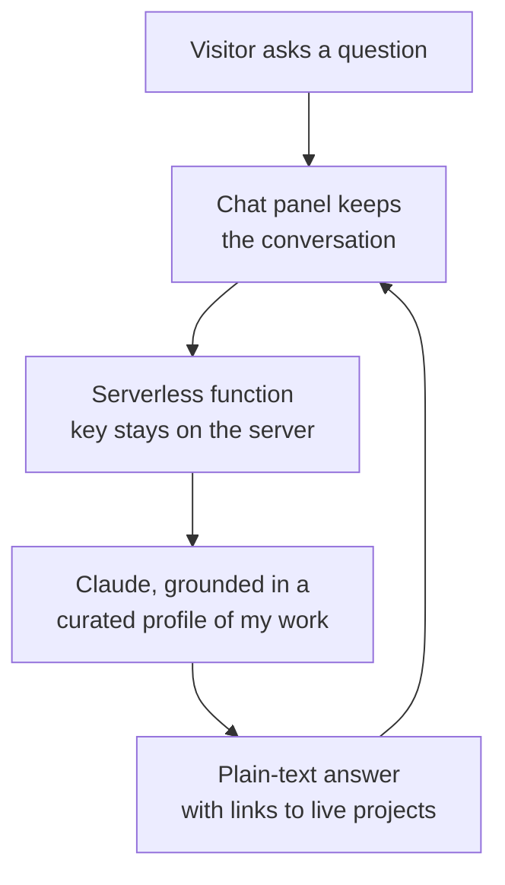

  

<h1 align="center">DH Portfolio</h1>

  <strong>A conversational portfolio: ask Davis Intelligence about my experience, projects, and skills, or browse the full portfolio by section.</strong> 
  <a href="https://portfolio.davishiggins.com"><strong>Ask a question ↗</strong></a> · <a href="https://www.higginsd.com/work/dh-portfolio">Case study</a> · <a href="https://davishiggins.com">davishiggins.com</a>

Live · Designed and built by Davis Higgins · Separate from <a href="https://davishiggins.com">davishiggins.com</a>, my motion-led personal site

---

## See it in motion

  

Real capture of the live assistant answering one question. The wait for the response is sped up. <a href="assets/demo.png">Static frame</a>

## What it does

- **Ask instead of scroll.** Davis Intelligence answers questions about my experience, projects, skills, education, and goals in plain language, with suggested questions to start.
- **Answers stay on topic.** The assistant works from a curated profile I wrote: roles, projects, stack, and links. It's instructed to represent me accurately and point to live projects.
- **Browsing is always there.** Home, Experience, Projects, Education, Skills, Impact, Résumé, and Contact remain one click away, and each project has a full write-up with an on-page index.

## Why I built it

A portfolio answers the questions its author anticipated, and no others. A recruiter wants to know about one technology; a prospective client wants to know whether I've done similar work. Making both of them hunt through pages written for a general audience is the wrong interface.

So the portfolio answers directly, and the conventional pages stay for anyone who would rather read.

## What I built

- The single-page portfolio: section navigation, project write-ups with an on-page index, experience timeline, skills, impact, and résumé
- Davis Intelligence: the chat panel, suggested questions, typing state, and conversation history
- The curated profile the assistant answers from, kept in step with my projects
- A serverless function that keeps the API key on the server and relays the conversation to Claude

## How a question is answered

### Engineering decisions

| Decision | Why |
|---|---|
| **The key never reaches the browser** | Requests go through a serverless function that holds the API key in the hosting environment. Visitors can't extract it from the page or its bundle. |
| **A curated profile, not open-ended generation** | The assistant answers from a profile I wrote and maintain, so answers stay on my real experience and projects instead of drifting into general knowledge. |
| **Conversation-aware, interface-safe** | The panel sends the running conversation so follow-up questions make sense, and strips formatting from replies so they render cleanly as chat bubbles. |

## Screens

<table>
  <tr>
    <td width="62%"></td>
    <td rowspan="2" width="38%" align="center"></td>
  </tr>
  <tr>
    <td></td>
  </tr>
</table>

Home · Projects with on-page index · Davis Intelligence on mobile

## Technology

| Layer | Technology | Responsibility |
|---|---|---|
| App | React, Vite, Tailwind CSS | Portfolio sections and layout |
| Motion | Framer Motion | Transitions and reveals |
| Assistant | Claude API through a Vercel serverless function | Answers grounded in the curated profile |
| Hosting | Vercel | Static site plus the serverless function |

## Notes

- **Correcting an earlier description.** Earlier write-ups described this as answering from structured data without a hosted model. The live assistant uses Claude, grounded in a curated profile. The project data also drives the browsable sections.
- **Accuracy depends on the profile.** The assistant is only as current as the profile I maintain. For anything critical, the résumé and contact pages are the source of truth.

## About this repository

This is a documentation-only showcase. The site's source and the assistant's instructions aren't included here.

**[Ask a question ↗](https://portfolio.davishiggins.com)** · Built by [Davis Higgins](https://davishiggins.com) · [More of my work](https://github.com/DavisHiggins)

© 2026 Davis Higgins. Text and images in this repository are shared for portfolio viewing. Claude is a trademark of Anthropic; this project is not affiliated with Anthropic.
