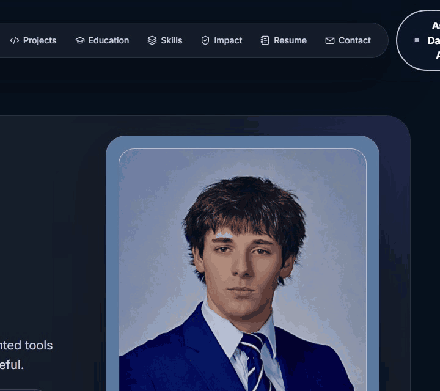
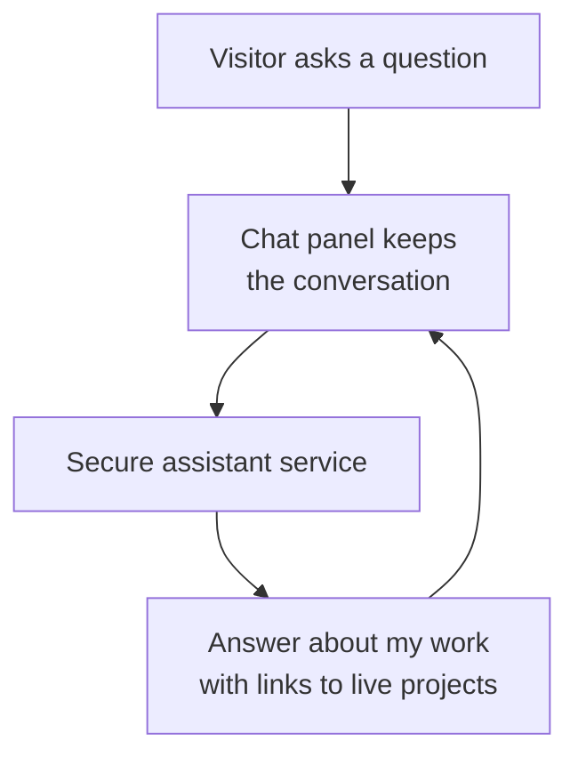
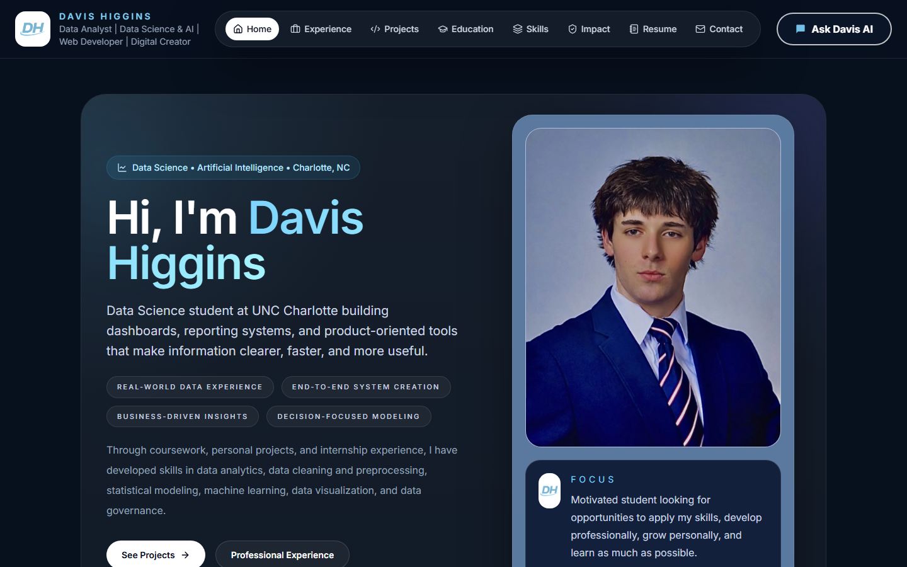
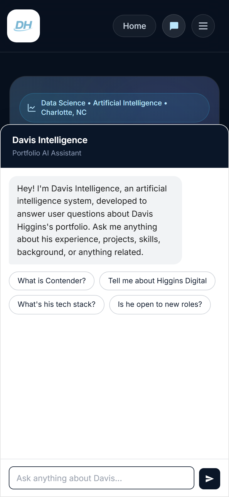
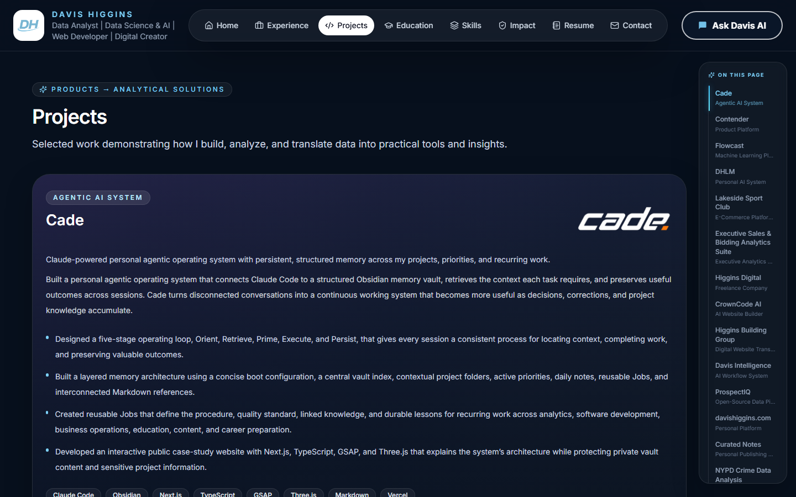

  

<h1 align="center">DH Portfolio</h1>

<strong>A conversational portfolio: ask Davis Intelligence about my experience, projects, and skills, or browse the full portfolio by section.</strong>

  &nbsp;
  &nbsp;
  

Live · Designed and built by Davis Higgins

---

## See it in motion

  

Real capture of the live assistant answering one question. <a href="assets/demo.png">Static frame</a>

## What it does

- **Ask instead of scroll.** Davis Intelligence answers questions about my experience, projects, skills, education, and goals in plain language, with suggested questions to get started.
- **Answers that stay on topic.** The assistant speaks to my real work and points visitors to the live projects behind it.
- **Browsing is always there.** Home, Experience, Projects, Education, Skills, Impact, Résumé, and Contact stay one click away, and each project has a full write-up with an on-page index.

## Why I built it

A portfolio answers the questions its author anticipated, and no others. A recruiter wants to know about one technology; a prospective client wants to know whether I've done similar work. Making both of them hunt through pages written for a general audience is the wrong interface.

So the portfolio answers directly, and the conventional pages stay for anyone who would rather read.

## What I built

- The single-page portfolio: section navigation, project write-ups with an on-page index, experience timeline, skills, impact, and résumé
- Davis Intelligence: the chat experience, suggested questions, typing state, and conversation memory
- The knowledge the assistant draws on, kept in step with my projects
- The secure service layer that powers the assistant

<strong>How it's put together</strong>

 

| Decision | Why |
|---|---|
| **Secrets never reach the browser** | The assistant runs behind a server-side service, so nothing sensitive ships in the page. |
| **Grounded in my real work** | Answers come from knowledge I write and maintain, not open-ended guessing. |
| **Conversation-aware** | Follow-up questions keep their context, and replies are formatted to read cleanly as chat. |

## Screens

<table>
  <tr>
    <td width="62%"></td>
    <td rowspan="2" width="38%" align="center"></td>
  </tr>
  <tr>
    <td></td>
  </tr>
</table>

Home · Projects with on-page index · Davis Intelligence on mobile

## Technology

| Layer | Technology |
|---|---|
| App | React, Vite, Tailwind CSS |
| Motion | Framer Motion |
| Hosting | Vercel |

---

  &nbsp;
  

© 2026 Davis Higgins. All rights reserved.

